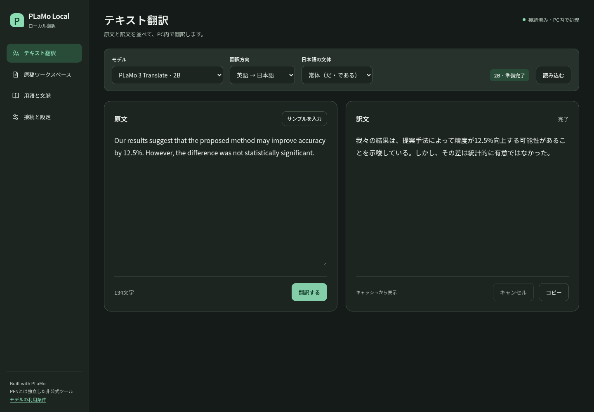

# PLaMo Local Translator

**Built with PLaMo — 非公式のローカル翻訳ツールです。**

PLaMo 3 Translateを使って、Chromeの選択文・ページ・論文原稿をPC内で翻訳します。PFN等が提供・推奨する公式アプリではありません。

## Windows / Mac用の操作アプリ（0.1.1）

初回セットアップ済みなら、Windows / Macの操作アプリから「起動」「停止」「接続キーを表示・コピー」を操作できます。日常の起動にターミナルは不要です。アプリを開くだけではAPIを起動しません。

[Windows / Mac版をダウンロード](https://github.com/kami9811/plamo-local-translator-public/releases/tag/controller-v0.1.1) · [初回の実行先設定からChrome接続まで](docs/DESKTOP.md) · [0.1.1の変更点](docs/releases/controller-0.1.1.md)

初めて使う場合は、[導入手順](docs/SETUP.md)でモデル・Python/WSL・Chrome拡張を準備してください。[動作確認した範囲](docs/DESKTOP-VALIDATION.md)



## 機能

- Chromeの選択文翻訳、吹き出し、右クリック、ショートカット、通常HTMLページの全文翻訳と原文復帰。
- 公式GGUFの2B / 8B切り替え、ローカル推論、状態表示。
- UTF-8のtxt / md / tex原稿、段落ごとの対訳、中断再開、数式・引用・コードの保護と数値確認。
- 用語集、分野・文脈、対訳履歴、名前付きプロファイル。
- 原文・下訳・設定・確認指示を含むレビュー用Markdown / JSON。生成元の表示とPLaMo契約全文も含めます。

## 動作確認環境

開発版 v0.1.4。WSL2 Ubuntu / Python 3.10 / NVIDIA RTX 4090 24GB / CUDA 12.6 / Windows Chromeで確認しています。Chrome 123以降が必要です。Windows用の操作アプリと、Apple Silicon / Intel向けMacアプリを追加しました。Macの検証条件は[デスクトップ版の検証記録](docs/DESKTOP-VALIDATION.md)に分けて記載しています。

モデル・Node.js・推論ランタイム・開発依存は初回に取得します。重みだけで約7.1GB、セットアップ全体には20GB程度以上の空き容量を推奨します。取得後の翻訳はローカルで実行します。

## セットアップ

```bash
git clone --branch v0.1.4 https://github.com/kami9811/plamo-local-translator-public.git
cd plamo-local-translator-public

# licenses/のPLaMo利用条件を読み、同意する場合のみ実行します。
python3 scripts/setup_runtime.py --accept-model-license
scripts/node.sh npm ci
scripts/node.sh npm run build
python3 scripts/start.py
```

商業目的でのモデル利用には事前登録等の別条件があります。上のフラグで登録が完了するわけではありません。[ライセンスの区分](NOTICE.md)を確認してください。

起動すると `http://127.0.0.1:8765/app.html` と拡張用の接続キーが表示されます。接続キーは公開しないでください。

### Chromeに拡張を追加する

まず拡張ファイルを用意します。自分で `scripts/node.sh npm run build` を実行した場合は、プロジェクト直下の **`dist` フォルダー**に作成されています。リリースの拡張ZIPを使う場合は、先にZIPを「すべて展開」してください。

WindowsのChromeでは、展開したファイル一式をWindows側のフォルダーに置きます。WSLでビルドした場合のコピー方法は[詳しい導入手順](docs/SETUP.md#chrome-extension)を参照してください。

1. Chromeで新しいタブを開き、アドレスバーに `chrome://extensions` と入力してEnterを押します。
2. 画面右上の「デベロッパーモード」をオンにします。
3. 「パッケージ化されていない拡張機能を読み込む」をクリックします。
4. フォルダーの選択画面で、用意した拡張のフォルダーを選び、「フォルダーの選択」を押します。選ぶのは **`manifest.json` が直接入っているフォルダー**です。
5. 一覧に「PLaMo Local」のカードが表示されたら、拡張の追加は完了です。

例えば、次の配置なら選択するフォルダーは `PLaMoLocalExtension` です。

```text
PLaMoLocalExtension/  ← Chromeでこのフォルダーを選択
  manifest.json
  background.js
  content.js
  app.html
  ...
```

`manifest.json` そのものを選ぶ操作ではありません。ソースコードのリポジトリ全体ではなく、ビルド済みファイル一式が入るフォルダーを指定します。

### 拡張に接続キーを登録する

1. コントローラーの「起動」→「接続キーを表示」→「コピー」を押します。CLIの場合は、リポジトリのターミナルで `python3 scripts/start.py` を実行します。CLIでは、表示された「拡張の接続設定に貼り付けるキー」の、コロン `:` より後ろの文字列だけをコピーします。
2. Chrome右上のパズルアイコン（拡張機能）を押し、一覧から「PLaMo Local」を開きます。ピン留めすると、次回からツールバーのアイコンで開けます。
3. 小さなメニューの「原稿・用語集・接続設定」をクリックします。
4. 新しいタブが開いたら、左メニューの「接続と設定」を選びます。
5. 「ローカルエンジンとの接続」にある「接続キー」欄へコピーした文字列を貼り付け、「接続する」を押します。
6. 画面上部に **「接続済み · PC内で処理」**と表示されれば、拡張とローカルAPIの接続は完了です。接続後にキーの入力欄が空になるのは正常です。

この操作は、アドレスが **`chrome-extension://` で始まる拡張の画面**で行ってください。`http://127.0.0.1:8765/app.html` を直接開いたブラウザ版が「接続済み」でも、拡張への接続キー登録は別に必要です。

### 翻訳を試す

通常のWebページを開き、英文を選択して右クリック →「PLaMoで選択文を翻訳」を選びます。初回はモデルの読み込みに時間がかかる場合があります。Chromeの設定画面やChrome Web Storeなどは翻訳対象外です。

推奨キーは選択文`Ctrl+Shift+Y`、ページ翻訳/復帰`Alt+Shift+U`。未割り当てや競合があれば`chrome://extensions/shortcuts`で変更できます。

停止は`python3 scripts/stop.py`。[詳しい導入手順](docs/SETUP.md)を参照してください。

## 通信とプライバシー

翻訳中の接続先はPC内のAPIと推論エンジンです。外部クラウド翻訳・利用状況送信・自動更新の処理はありません。v0.1.4ではプロキシ・リダイレクトの拒否、拡張の接続先制限、推論のオフライン指定を追加しました。

初回のモデル・依存関係取得と、利用者がGitHub等の案内リンクを開く場合はインターネット通信があります。Chrome・閲覧先サイト・OSの通信を全面的に禁止するソフトではありません。[確認した範囲と更新方法](docs/NETWORK-SECURITY.md)

## 論文の下訳とレビュー

「用語と文脈」で設定を保存し、「原稿ワークスペース」で原稿を投入します。下訳と原文を見比べ、警告を確認してからレビュー用ファイルを出力してください。

AgenticVibe等の後段フローへは原文付きファイルを渡す構成です。外部Agentを自動で呼び出すAPI連携はありません。[引き渡し形式](docs/HANDOFF.md)

## 実測

RTX 4090で、モデル読み込み後・アプリの翻訳キャッシュ無効・各3回の中央値。

| 入力 | 2B | 8B |
|---|---:|---:|
| 英語127文字→日本語 | 0.095秒 | 0.200秒 |
| 日本語2,689文字→英語 | 3.963秒 | 8.766秒 |

UIの待ち時間や初回読み込みは含みません。llama.cppのプロンプトキャッシュは有効です。測定は同じ翻訳コアで行ったもので、今回の帰属表示追加による性能差を主張しません。[条件・品質例・制限](docs/VALIDATION.md)

## ライセンス

独自のアプリコードは[MIT](LICENSE)。モデルとPLaMo生成部分には[PLaMo Community License](licenses/PLaMo-Community-License-ja.txt)が適用され、アプリのMITライセンスでその条件を緩和しません。

訳文サンプル、ベンチマークの訳文、画像内の訳文はPLaMo 3 Translateの生成物です。**Built with PLaMo。** [第三者の権利・区分](NOTICE.md)

デザインはMaterial 3 ExpressiveとCarbonの原則を参考にした自作CSSです。公式の準拠認証や、各社との提携を表すものではありません。[デザイン方針](docs/DESIGN.md)

## 開発

```bash
python3 -m unittest discover -s tests -v
scripts/node.sh npm run typecheck
scripts/node.sh npm run build
python3 scripts/package.py
```

実モデルのブラウザ検証は作業データ・設定を作成するため、専用のテスト環境で実施してください。保存データは`.data/`、モデル等は`.runtime/`。いずれもGitとリリースに含めません。[アーキテクチャ](docs/ARCHITECTURE.md)

日本語UIにはNoto Sans JPを同梱しています。フォントのための外部通信は不要です。書体のOFLは `licenses/fonts/`、文字組みと配置の判断は [デザイン方針](docs/DESIGN.md) を参照してください。
