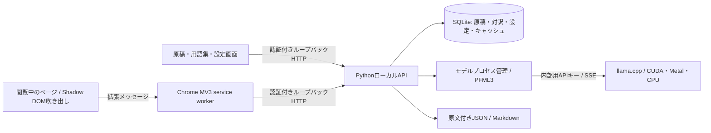

# アーキテクチャ

## 責務

- `extension/src/background.ts`: user actionからcontent scriptを注入し、接続キーをtrusted context内に保持してAPI通信を仲介。
- `content.ts`: 選択文の吹き出し、全文のテキストノード置換・復帰。Shadow DOM・共有トークン・構築済みスタイルシート。
- `app.ts`: 原稿、設定、用語集、プロファイル、出力の画面。
- `shared.ts`: 型と認証済みクライアント。本文をHTMLとして挿入しない。
- `server/plamo_local/service.py`: HTTP検証、タスク、原稿ジョブ、状態とキャンセル。
- `engine.py`: 1モデルずつのプロセス管理、公式PFML3、トークン上限確認、ネイティブSSE受信、実測。
- `documents.py`: 原稿分割、数式・引用・コードなどのマーカー保護、数値照合、原文付き出力。
- `store.py`: SQLiteの原稿・設定・キャッシュ保存。

## 通信と権限

APIは127.0.0.1:8765、推論は127.0.0.1:8766。外部URLを代理取得する機能はありません。APIはHostとOriginを制限し、原稿などの操作には接続キーを要求。ローカルの同一オリジン画面だけがbootstrapで接続できます。拡張は初回にキーを登録します。推論サーバーにもプロセスごとの内部APIキーを設定します。

拡張のサイトへの権限はactiveTabとユーザー操作による注入。永続ホスト権限はlocalhost/127.0.0.1への通信に限定します。接続キーはcontent scriptへ渡しません。

## ジョブと再開

原稿作成時に翻訳設定とモデル情報を固定し、段落IDと原文・区切りを保存。完了済み段落は再開時に保持します。停止時はキャンセルし、原稿ワーカーの保存とプロセス終了を待ちます。再起動時に処理中だった原稿は中断状態に戻します。訳抜けなど意味全体の検証は後段の原文照合に委ねます。

キャッシュキーは原文、モデルと重みのrevision、翻訳方向、文体、分野、文脈、用語集、直前の対訳履歴、保護処理バージョンから計算。警告を含む結果はキャッシュしません。

## 主なAPI

| 操作 | パス |
|---|---|
| 状態・設定・一覧 | GET /api/state |
| 設定保存 | POST /api/settings |
| モデル読み込み / 停止 | POST /api/models/load, /stop |
| 単発翻訳作成・状態取得・中断 | POST /api/translations, GET /api/translations/:id, POST /:id/cancel |
| 原稿作成・取得 | POST /api/jobs, GET /api/jobs/:id |
| 原稿の中断・再開・失敗再実行 | POST /api/jobs/:id/cancel, /resume, /retry |
| 原稿出力 | GET /api/jobs/:id/export?format=json / md / translated |
| 名前付き設定 | POST /api/profiles, DELETE /api/profiles/:id |
| データ削除 | DELETE /api/jobs/:id, /api/cache, /api/data |

外部AgentのAPIは仮定せず、⑤は検証済みのファイル契約で分離しています。

## デスクトップ操作アプリ

WindowsはWPF / .NET Framework、MacはSwift / AppKitのネイティブ画面。コントローラー自体はHTTPで原稿を扱わず、Pythonの共有ブリッジで起動・停止・キー表示を実行します。Windowsはwsl.exeの--exec、MacはFoundation.Processを使い、パスをシェル文字列として評価しません。Windowsにはgzipで埋め込み、MacはResourcesへ同梱するため、旧版のセットアップ済みチェックアウトも操作できます。

共有ブリッジはプロセスのモジュール名・作業ディレクトリ・待ち受けソケットを確認します。別チェックアウトのAPIには接続キーを送らず、停止も行いません。APIのヘルスチェックは無認証、明示的なキー表示では所有元を確認したうえで保存キーを読み、認証済みAPIへの接続を照合します。ループバック通信にプロキシやリダイレクトを使用しません。

CLIのstart.py / stop.pyも同じブリッジを使います。GUI起動・終了にAPIの自動起動・自動停止を結び付けません。モデルは従来通りAPIが管理します。Macは公式Metalバイナリを選び、CPU検証用にPLAMO_GPU_LAYERS=0も受け付けます。
