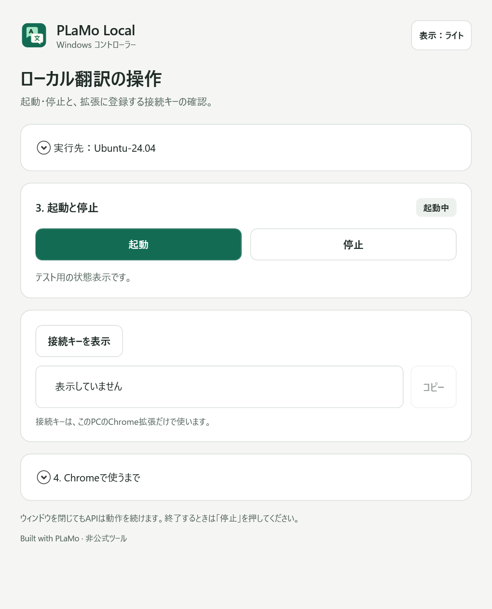
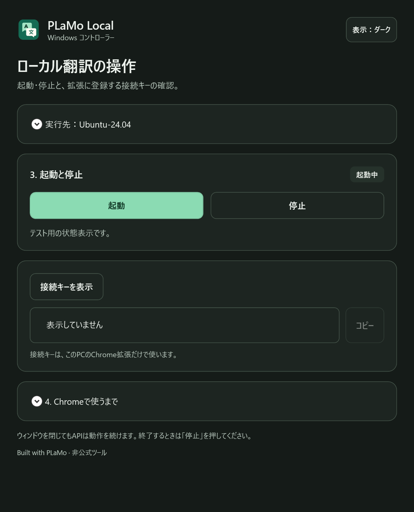
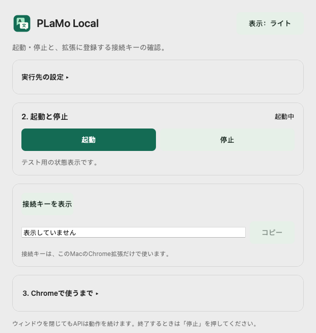
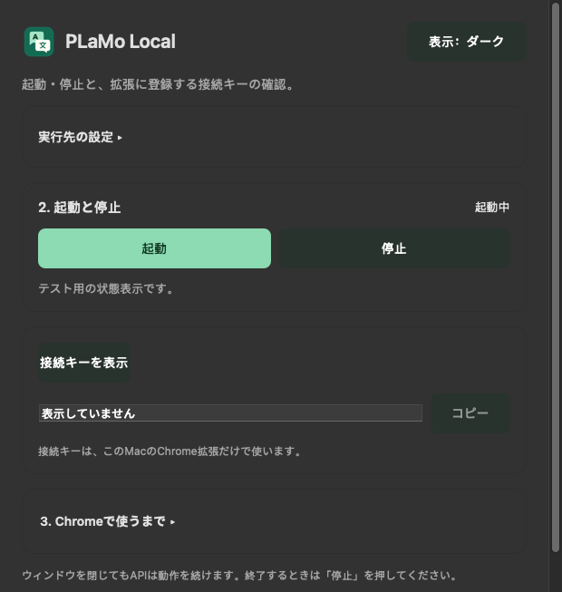
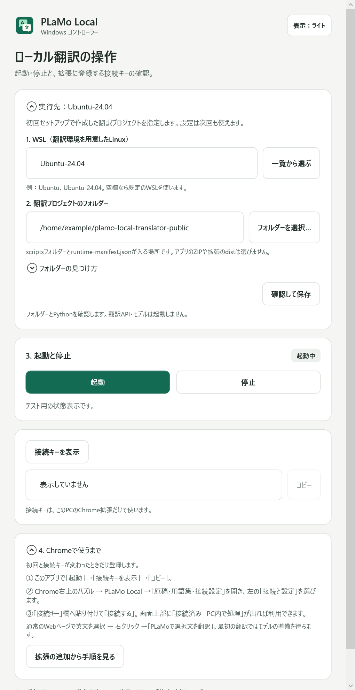
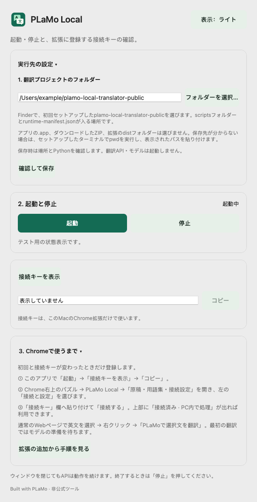

# デスクトップ版の検証記録

2026-11-06更新。コントローラー0.1.1 / 翻訳アプリ0.1.3。Built with PLaMo。以下の訳文はPLaMo 3 Translateの生成物です。[モデル・生成物の条件](../licenses/PLaMo-Community-License-ja.txt)

## 0.1.1の追加検証（2026-11-06）

[更新版Mac CI](https://github.com/kami9811/plamo-local-translator-public/actions/runs/42178600422)は両ジョブ成功。アプリのコードは `b9500a5a04ab98e96b88079859a07510bc4b88eb`。その後の変更は文書・画像・検証記録です。

| 対象 | 追加で確認したこと |
| --- | --- |
| Windows（Public / Private） | それぞれ30項目通過。独自アイコン、WSL一覧のUTF-16/UTF-8処理と実取得、共有パスからの実行先抽出、実Windowsのフォルダー選択ダイアログの起動・キャンセル、設定確認がstatusだけを呼ぶこと、誤った設定を保存しないこと、Chromeガイドの入口、従来の3操作・設定保存・実WSL引数を確認。起動/停止のボタン操作は代替バックエンド。手元の実API/モデルは起動・停止していない。 |
| Macネイティブ画面 | Apple Silicon / Intelで各20項目通過。独自アイコン、正しい/誤ったフォルダー選択、statusによる確認・保存、接続ガイド、コピー欄の幅、ライト/ダークの表示、従来のキー表示/コピー/クリアとエラー回復を確認。画面テストは代替バックエンド。 |
| Mac実API・配布 | 両MacでAppKit→Python→実APIの起動・明示キー表示・停止を再確認。Universalビルド・アドホック署名、CFBundleIconFileと同梱ICNS、macOSのiconutilによる展開を確認。 |
| 回帰・情報管理 | Public Python16件、Private13件、型チェック・拡張ビルド・Windowsビルドが成功。公開履歴の秘密情報検査で検出0件。両ZIPのSHA256、ライセンス、実キー・私用パス・モデル/原稿/設定の非同梱を確認。 |

推論処理・モデルは変更しておらず、0.1.1では実モデルの速度を再測定していません。共通ブリッジの隔離API6件は更新CIのarm64で実施し、Intelでの同一テストは重複実行を省いています。以下の0.1.0時点の実モデル検証を基準にし、UI/実APIの検証と区別します。生成した導入ガイドの文言はChrome拡張の実際のラベルと照合しました。拡張側のキー登録はコントローラーから自動取得しないため、Chromeで接続済みを確認する手順です。

機械可読の追加結果は[controller-0.1.1.json](validation/desktop/controller-0.1.1.json)と、同フォルダーのwindows-setup / macos-011の各JSONに保存しています。

## 0.1.0時点の検証の範囲

[0.1.0のMac CI](https://github.com/kami9811/plamo-local-translator-public/actions/runs/42007817736)は両ジョブ成功。検証したコードは `eb9d83ef8ef7e7a74edce58d8a756e72129c07f1`。その後の変更は文書・検証記録・画面画像です。

| 対象 | 結果と条件 |
| --- | --- |
| Windows | 実Windows上のWPF画面描画・操作・ライト/ダーク、設定保存、キーの明示表示とクリア、WSL引数のUnicode/特殊文字/引用符、組み込みブリッジの読み取り専用status、計16チェック通過。ボタンの起動/停止は代替バックエンドで検証。 |
| 共通ブリッジ | Linux・両Macで隔離した代替APIの6テスト通過。起動・停止・再操作、別チェックアウト/別プロセス保護、誤ったキー、ロック、保存データ保持を確認。モデル推論のテストではない。 |
| Macネイティブ画面 | arm64 / Intelで各13チェック通過。AppKit描画、ライト/ダーク、見出しの表示範囲、起動/停止操作、キー表示、コピー、設定への非保存、エラー回復を検証。画面テストのバックエンドは代替。 |
| Mac実API | 両Macでネイティブ操作画面→Foundation.Process→Python→実APIの起動・キー表示・停止を確認。キーを設定に保存しないことも確認。モデルはこの段階では読み込まない。 |
| Mac実モデル | GitHubホストのmacOS 15.8.2 arm64で2B、15.7.9 Intelで2B→8Bの切り替えと翻訳を確認。公式Q4_K_M、llama.cpp b12121、CPUモード（PLAMO_GPU_LAYERS=0）、コンテキスト16,384。終了後に8765/8766の両ポートが閉じることを確認。 |
| ビルド等 | Public Python 16件、Private Python 13件、両方のTypeScript型チェック・Chrome拡張ビルド・Windowsアプリビルドが成功。Privateの設定ポートとHost/Origin拒否をimportのみで確認。Mac Universalは両CPU向けビルド・アドホック署名検証に成功。 |

Windowsのユーザー環境では、依頼に従い実API・実モデルを新たに起動・停止していません。既存のChrome/RTX 4090での翻訳検証は[従来の検証記録](VALIDATION.md)に分けています。今回、MacのChrome拡張の全操作テストは実施していません。

## Mac CPUでの単発実測

初回のモデル読み込みを含む1回ずつの機能確認です。キャッシュヒットはfalse。入力は英語57文字、出力は日本語19文字。TTFTと翻訳時間は読み込み後の値、合計はHTTP投入から完了確認までです。仮想CI環境の結果で、一般的なMacの速度やMetalの性能を表すものではありません。

| CPU | モデル | 読み込み | TTFT | 翻訳時間 | 合計 |
| --- | --- | ---: | ---: | ---: | ---: |
| arm64 | 2B | 46.104秒 | 0.737秒 | 1.409秒 | 47.721秒 |
| x86_64 | 2B | 15.904秒 | 1.523秒 | 2.722秒 | 18.863秒 |
| x86_64 | 8B | 34.591秒 | 4.193秒 | 7.146秒 | 42.568秒 |

原文: `This study evaluates the accuracy of the proposed method.`

両モデルの出力: 「本研究では、提案手法の精度を評価する。」この一例だけでモデル間の品質が同じとは判断しません。論文の主張・数値・引用の確認は原文と合わせて行います。

## 配布物と情報管理

- Windows ZIP: EXE、.NET設定、説明、MIT/NOTICE/PLaMo利用条件。
- Mac ZIP: Universal arm64/x86_64の.app、共有ブリッジ、説明、ライセンス。最低OS指定は12.0、確認したOSは上記15系。
- 両ZIPで同梱ブリッジが検証したソースと一致することを照合。Macの両CPUスライスと署名情報を確認。
- 公開Git履歴をgitleaksで検査し、検出0件。実際の接続キー・私用のユーザーパス等についても配布物を照合し、混入0件。モデル・原稿・.data・.runtime・controller.jsonを配布しない。
- 保存先・削除方法・起動/終了時の挙動は[導入手順](DESKTOP.md)に記載。

## 画面

以下は0.1.1のテスト用設定と代替バックエンドを表示したネイティブ画面です。個人の原稿・実際の接続キーは使っていません。

WindowsとMacの設定・Chromeガイドを開いた状態。Macの設定画像はスクロール領域全体のネイティブ描画です。

## 未検証・制限

- MacのMetal/GPU推論、Apple Siliconでの8B、利用者個別のMacとChromeでの操作は未検証。通常のMac実行はMetalを指定し、CPUへ変更する場合はPLAMO_GPU_LAYERS=0を指定してCLI起動する。
- Windows EXEはコード署名なし。Macはアドホック署名で、Developer ID署名・Apple公証なし。Macの初回起動方法は導入手順を参照。
- Narrator/VoiceOverでの全操作、全OS設定におけるキーボード操作・コントラストの包括的な監査は未実施。WCAGの全面適合認証を主張しない。
- 初回のPython/WSL/モデル/Chrome拡張のセットアップは別途必要。アプリには自動インストール、自動起動、トレイ常駐、外部サービスへの原稿送信は実装しない。

機械可読の結果は[validation/desktop](validation/desktop/)に保存しています。API操作・代替API・実モデルの結果を別ファイルで記録しています。実モデルのJSONには帰属表示・契約全文と元のCI結果のSHA256を追加し、翻訳・測定値はそのまま保持しています。
