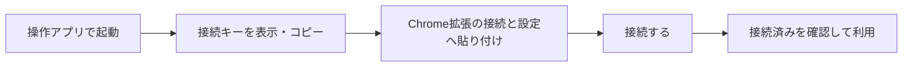
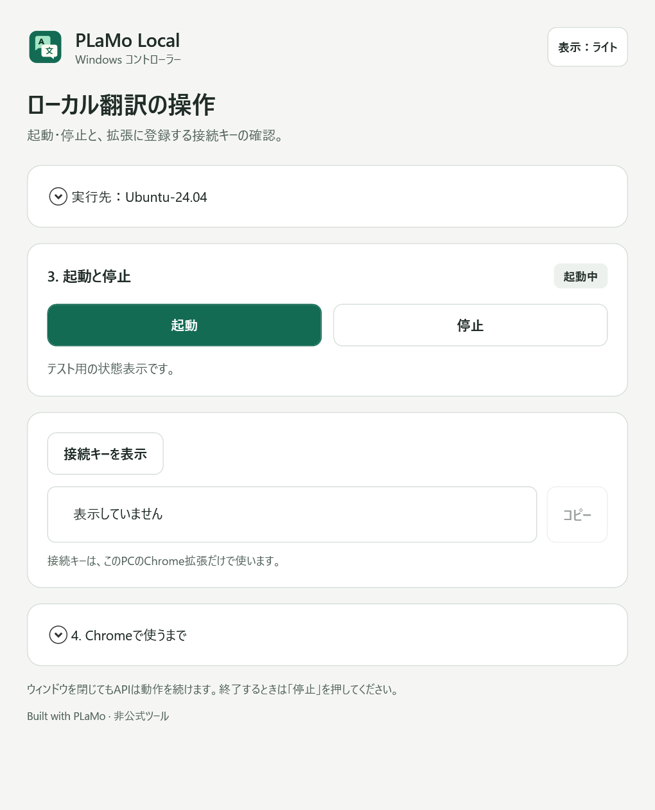
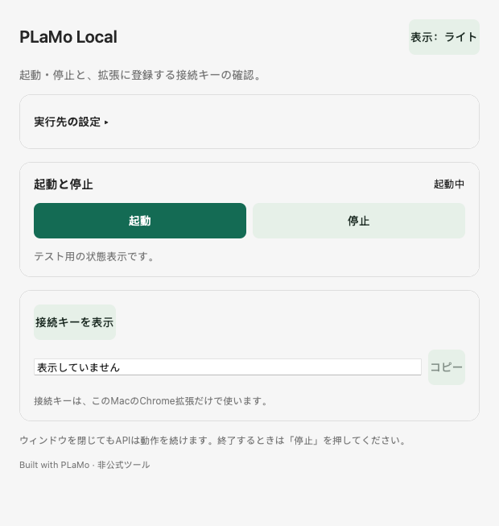

# 操作アプリ0.1.1 — アイコンと初回設定ガイド

2026年11月6日。Windows / Macの操作アプリ0.1.1を公開しました。翻訳アプリは0.1.3のままです。

[Windows / Mac版をダウンロード](https://github.com/kami9811/plamo-local-translator-public/releases/tag/controller-v0.1.1) · [導入手順](https://github.com/kami9811/plamo-local-translator-public/blob/controller-v0.1.1/docs/DESKTOP.md)

| 場所 | 0.1.0 | 0.1.1 |
| --- | --- | --- |
| アイコン | OS標準 | EXE・タイトルバー・Finder/Dockに独自の翻訳アイコン |
| WindowsのWSL名 | 手入力 | インストール済みの一覧から選択 |
| 実行先 | パス入力・ドラッグ | フォルダー選択、共有パスからWSL名とLinuxパスを自動入力 |
| 設定保存 | 入力を保存 | APIを起動せず確認し、成功した場合だけ保存 |
| 案内 | 起動・停止が中心 | キー取得からChromeの接続完了まで |

## 使い始めるまで

初回セットアップ済みの翻訳プロジェクトを選び、「確認して保存」を押します。WindowsはWSLの一覧とフォルダー選択、MacはFinderのフォルダー選択を使えます。

Chrome右上のパズル → PLaMo Local →「原稿・用語集・接続設定」→ 左の「接続と設定」を開きます。「接続キー」へ貼り付けて「接続する」。上部の「接続済み · PC内で処理」を確認してください。同じキーなら次回から再登録は不要です。

コントローラー自身は拡張の登録完了を取得しません。「起動中」とChrome側の「接続済み」は別の状態です。モデル・Python/WSL・Chrome拡張の初回セットアップは別途必要です。

## 実画面

代替APIを表示したネイティブ画面です。実モデルの訳文や実際のキー、個人の原稿は使っていません。

### Windows

### Mac

## 確認した範囲

| 対象 | 結果 |
| --- | --- |
| Windowsのネイティブ画面・操作・実WSL一覧・OSフォルダー選択 | Public / Private各30項目成功 |
| Macのネイティブ画面・操作・ガイド | Apple Silicon / Intel各20項目成功 |
| Mac実API | 両CPUで起動・明示キー表示・停止を確認 |
| ビルド | 型チェック、Chrome拡張、Windows、Mac Universal、ICNS成功 |
| Python | Public16件 / Private13件成功 |

[検証条件・記録](https://github.com/kami9811/plamo-local-translator-public/blob/controller-v0.1.1/docs/DESKTOP-VALIDATION.md)。操作アプリの起動/停止の画面テストと、Macの実API検証を分けています。モデル推論は変更せず、今回の速度再測定はしていません。従来の2B/8B実モデル記録を保持しています。

Mac Metal、Apple Siliconの8Bは未検証。Windowsは未署名、Macはアドホック署名・Developer ID署名/公証なしです。

## 更新する場合

旧操作アプリを閉じ、新しいZIPを別のフォルダーへ展開して起動します。既存の実行先・テーマ設定を使い続けられます。翻訳APIの自動起動・停止はしません。

システム全体のキャッシュ解放や、WSLの停止・設定変更は今回行っていません。トップREADMEの入口追加は[PR #2](https://github.com/kami9811/plamo-local-translator-public/pull/2)で用意し、mainは変更していません。

Built with PLaMo · 非公式。独自コード・アイコンはMIT。PLaMoモデルと生成物には同梱のPLaMo利用条件が適用されます。
